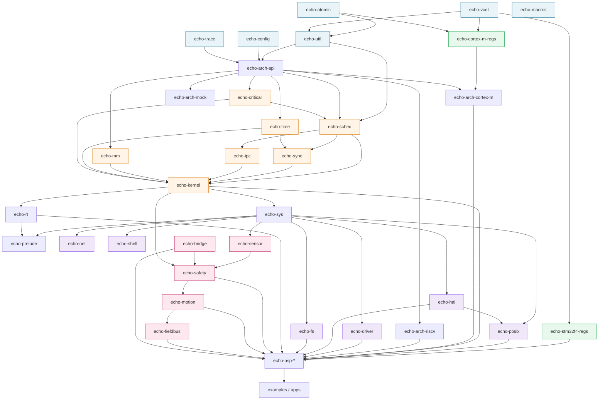

# 04 · 多 crate 工程布局

## 4.1 为什么用多 crate 而不是单 crate + feature

| 维度 | 单 crate + feature | **多 crate（选择）** |
| --- | --- | --- |
| 依赖边界 | 靠约定，容易穿透 | **编译器强制**：没写依赖就用不了 |
| 编译单元 | 改一行全量重编 | 增量编译只重编受影响 crate |
| 分层校验 | 人工 review | **`xtask` 可自动校验依赖图** |
| `unsafe` 管控 | 全局 `deny`，难开口子 | **按 crate 精确授权**，其余强制 `deny(unsafe_code)` |
| 测试隔离 | 难以 mock 底层 | 换成 `echo-arch-mock` 即可在 host 测内核 |
| 对外发布 | 只能整包发 | 各 crate 可独立版本化/发布 |
| 代价 | — | crate 数量多，需要 xtask 统一入口治理 |

**结论**：多 crate 的收益集中在"边界由编译器保证"和"unsafe 白名单"两点上，对 OS 这类长周期、高可靠性要求的项目是决定性优势。代价用 `xtask` 抹平。

> **L1 策略放大了多 crate 的价值**（[ADR-0014](05-design-decisions.md#adr-0014--零外部-crate-依赖l1-完全自研)）。原本由 `cortex-m`、`embedded-hal`、`heapless`、`portable-atomic` 等 crate 提供的功能，现在由 `echo-atomic`、`echo-vcell`、`echo-hal`、`echo-util` 承担。这些自研基础设施的边界越清晰，被复用的部分（内核逻辑）就越不需要改动。
>
> **机器人场景（[02](02-embodied-ai-robot-profile.md)）又增加了约 7 个 crate**（`echo-safety` / `echo-motion` / `echo-bridge` / `echo-fieldbus` 及其子 crate / `echo-sensor`）。当前设计规模：**约 42 个 crate**。
>
> **`crates/robot/*` 属于阶段二/三，当前不实现**（[ADR-0019](05-design-decisions.md#adr-0019--分阶段交付实时控制优先)）。但其中的架构不变式**现在就要固化**：
>
> 依赖方向必须是**单向**的 `bridge → safety → motion → fieldbus`。这个顺序不可颠倒——它编码了 [02 §2.8.1](02-embodied-ai-robot-profile.md#281-ai-与硬实时的边界安全包络与命令仲裁--阶段三) 的三层防护模型。`xtask lint-deps` 应**在阶段一就加上这条链的方向校验**，即使 crate 尚未存在——否则等阶段三再补，架构已经被污染。

## 4.2 命名约定

- 仓库名：`echoos`
- crate 目录名：`echo-<domain>[-<impl>]`（kebab-case），如 `echo-arch-cortex-m`
- crate 包名：同上，如 `echo-arch-cortex-m`
- crate lib 名：`echo_<domain>_<impl>`（snake_case），如 `echo_arch_cortex_m`
- 所有 crate **必须** `#![no_std]`（除明确标注 `host-test-only` 的）

## 4.3 完整目录树

```
echoos/                                    # workspace 根
├── Cargo.toml                             # [workspace] 定义（虚拟清单，无 [package]）
├── Cargo.lock                             # 提交进版本控制（OS 不是库）
├── rust-toolchain.toml                    # 固定 1.98.1 + targets
├── .cargo/
│   └── config.toml                        # target、rustflags、runner、alias
├── rustfmt.toml
├── clippy.toml
├── deny.toml                              # cargo-deny 配置
├── .github/workflows/
│   ├── ci.yml                             # 主 CI
│   └── latency-bench.yml                  # 延迟基准回归
├── xtask/                                 # 构建编排（见 §4.6）
│   ├── Cargo.toml
│   └── src/
│       ├── main.rs
│       ├── cmd/
│       │   ├── build.rs                   # 构建指定 BSP/示例
│       │   ├── run.rs                     # QEMU 运行
│       │   ├── test.rs                    # 分层测试
│       │   ├── bench.rs                   # 实时性基准
│       │   └── lint_deps.rs               # ★ 依赖规则校验
│       └── bsp.rs                         # BSP 元数据解析
│
├── docs/                                  # 本目录
│
├── crates/
│   │
│   ├── core/                              # ── L0：零依赖的基础设施（全自研）
│   │   ├── echo-atomic/                   # ★ 自研原子抽象（替代 portable-atomic）
│   │   │   └── src/                       #   M3+ 用原生 CAS；M0/M0+ 用临界区模拟
│   │   ├── echo-vcell/                    # ★ 自研寄存器内部可变性封装（替代 vcell）
│   │   │   └── src/                       #   UnsafeCell + 读写权限类型标记
│   │   ├── echo-util/                     # 数据结构的"标准库"
│   │   │   └── src/
│   │   │       ├── lib.rs
│   │   │       ├── intrusive_list.rs      # 侵入式双向链表（就绪队列用）
│   │   │       ├── ring_buffer.rs         # SPSC 环形缓冲（ISR→任务）
│   │   │       ├── bitmap.rs              # 就绪位图（O(1) 找最高优先级）
│   │   │       ├── once.rs                # OnceCell / LazyCell
│   │   │       ├── cell.rs                # SyncUnsafeCell 等内部可变性封装
│   │   │       ├── deque.rs               # 有界双端队列
│   │   │       ├── vec.rs                 # ★ 固定容量 Vec（替代 heapless）
│   │   │       ├── string.rs              # ★ 固定容量 String
│   │   │       └── time.rs                # Instant / Duration（无 std）
│   │   ├── echo-config/                   # 编译期配置常量（见 02 §3.5.6）
│   │   ├── echo-macros/                   # proc-macro：#[echo::task] 等
│   │   └── echo-trace/                    # 内核 trace / 日志（自研后端）
│   │
│   ├── regs/                              # ── L1：寄存器定义（全部由 svdgen 生成）
│   │   ├── echo-cortex-m-regs/            # ★ Cortex-M 核心寄存器，自研手写
│   │   │   └── src/                       #   (规模小且稳定：NVIC/SCB/SysTick/MPU/DWT)
│   │   │       ├── nvic.rs
│   │   │       ├── scb.rs
│   │   │       ├── systick.rs
│   │   │       ├── mpu.rs
│   │   │       ├── dwt.rs
│   │   │       └── cpuid.rs
│   │   ├── echo-stm32f4-regs/             # 生成产物（检查进版本库）
│   │   ├── echo-riscv-regs/               # 生成产物（CLINT/PLIC/CSR）
│   │   └── ...                            # 每支持一颗芯片 = 一个 crate
│   │
│   ├── arch/                              # ── L1：体系结构抽象与实现
│   │   ├── echo-arch-api/                 # trait Arch + 通用类型，零硬件依赖
│   │   ├── echo-arch-cortex-m/            # ARM Cortex-M0+/M3/M4/M7/M33
│   │   │   └── src/
│   │   │       ├── lib.rs
│   │   │       ├── asm.rs                 # ★ 唯一允许内联汇编的地方
│   │   │       ├── context.rs             # 栈帧布局定义
│   │   │       ├── mpu.rs                 # MPU region 编程
│   │   │       ├── nvic.rs                # 中断控制
│   │   │       ├── systick.rs             # 节拍源
│   │   │       └── vector.rs              # 向量表
│   │   ├── echo-arch-riscv/               # RV32IMAC（含 CLINT/PLIC）
│   │   ├── echo-arch-cortex-r/            # ★ Cortex-R52/R5F（GIC、TCM、锁步）
│   │   │   └── src/                       #   目标：Jetson Orin 安全岛等
│   │   └── echo-arch-mock/                # ★ host 测试用模拟实现（可记录调用序列）
│   │
│   ├── kernel/                            # ── L3/L4：内核主体
│   │   ├── echo-critical/                 # CriticalSection RAII + BASEPRI 抽象
│   │   ├── echo-mm/                       # 内存管理
│   │   │   └── src/
│   │   │       ├── lib.rs
│   │   │       ├── pool.rs                # 固定块内存池（O(1)，无碎片）
│   │   │       ├── tlsf.rs                # TLSF 分配器（O(1) 最坏情况）
│   │   │       ├── stack.rs               # 任务栈 + 水位线/守卫
│   │   │       └── global_alloc.rs        # 可选 #[global_allocator]
│   │   ├── echo-time/                     # 时钟、tickless 定时器、软件定时器
│   │   ├── echo-sched/                    # 调度器（就绪队列、PIP、idle）
│   │   ├── echo-sync/                     # Mutex/Semaphore/EventGroup/RwLock
│   │   ├── echo-ipc/                      # Queue/Channel/Mailbox
│   │   └── echo-kernel/                   # ★ 内核门面：组装上述子系统
│   │
│   ├── api/                               # ── L4/L5：对外接口
│   │   ├── echo-sys/                      # 稳定的系统调用式 API（用户与内核的契约）
│   │   ├── echo-pal-api/                  # ★ PAL 5 域契约（Micro；DoraOS 共用）
│   │   ├── echo-rt/                       # #[echo::main] / entry / 运行时启动
│   │   └── echo-prelude/                  # pub use 集合，`use echoos::prelude::*`
│   │
│   ├── services/                          # ── L6：可裁剪的中间件（全部自研）
│   │   ├── echo-driver/                   # 驱动模型 + 编译期设备树 + 中断绑定
│   │   ├── echo-hal/                      # ★ 自研 HAL trait 体系（概念对齐 embedded-hal）
│   │   ├── echo-fs/                       # 日志结构文件系统（掉电一致）
│   │   ├── echo-net/                      # ⏸ 通用 TCP/IP —— 已列为非目标（见 02 §2.7）
│   │   ├── echo-shell/                    # 交互式调试 shell（串口）
│   │   ├── echo-ota/                      # 固件升级 + A/B 双分区
│   │   └── echo-posix/                    # ★ 可选：PSE51 子集兼容分区（ADR-0020，v1）
│   │
│   ├── robot/                             # ── ⏩ 阶段二/三：当前不实现（见 02 §2.3）
│   │   ├── echo-motion/                   # ⏩ 阶段二：轨迹插值 + 多关节同步
│   │   │   └── src/
│   │   │       ├── interp.rs              #   航点 → 高频设定点插值
│   │   │       ├── jerk.rs                #   加加速度限制（C² 连续）
│   │   │       ├── multi_joint.rs         #   多关节共享时间基准
│   │   │       └── filters.rs             #   低通/陷波/前馈（控制常用）
│   │   ├── echo-fieldbus/                 # ⏩ 阶段二：现场总线抽象
│   │   │   ├── echo-can/                  #   CAN / CAN-FD（自研可行）
│   │   │   ├── echo-ethercat/             #   EtherCAT 从站（⏸ 见 02 §2.9 的 L1 冲突）
│   │   │   └── echo-bus-sync/             #   总线时钟同步（DC/PTP 类）
│   │   ├── echo-sensor/                   # ⏩ 阶段二：同步采样与传感器融合
│   │   │   └── src/                       #   定时器触发 ADC+DMA、IMU 融合
│   │   ├── echo-safety/                   # ⏩ 阶段三：安全包络 + 命令仲裁
│   │   │   └── src/                       #   AI 命令的语义边界（不可绕过）
│   │   │       ├── envelope.rs            #   关节限位/工作空间/速率限制
│   │   │       ├── freshness.rs           #   命令新鲜度与超时降级
│   │   │       ├── state.rs               #   INIT/READY/ACTIVE/DAMPING/FAULT/ESTOP
│   │   │       └── limits.rs              #   限值定义（编译期常量）
│   │   └── echo-bridge/                   # ⏩ 阶段三：与 AI 栈的有界延迟接口
│   │       └── src/
│   │           ├── shmem.rs               #   固定布局无锁共享内存环
│   │           ├── framing.rs             #   序号/时间戳/CRC/版本协商
│   │           └── transport/             #   共享内存 / 以太网 / 串口 后端
│   │
│   └── test/                              # ── 测试基础设施
│       ├── echo-testkit/                  # QEMU 集成测试框架 + semihosting 断言
│       ├── echo-bench/                    # 实时性基准（★ 必须报告分布 P50/P99/max）
│       └── echo-conformance/              # 跨平台一致性测试套件（同一份测试跑所有 arch）
│
├── bsp/                                   # ── 板级支持包（每个 = 一个可执行目标）
│   ├── echo-bsp-qemu-cortex-m/            # QEMU mps2-an385/an500 (Cortex-M3/M7)，CI 用
│   ├── echo-bsp-qemu-riscv-virt/          # QEMU virt (RV32IMAC)，可移植性验证
│   ├── echo-bsp-qemu-x86/                 # QEMU x86_64 + OVMF (UEFI)，三架构冒烟测试
│   ├── echo-bsp-nucleo-h743zi/            # ★ 首选真机：STM32H743 (Cortex-M7 @480MHz,
│   │                                      #   D-Cache + TCM) —— 见 02 §2.6.3
│   ├── echo-bsp-stm32h7-joint/            # ★ 关节控制器参考设计（电机驱动 + CAN-FD）
│   ├── echo-bsp-nucleo-f401re/            # STM32F401RE (Cortex-M4F)，简化验证
│   ├── echo-bsp-stm32h7-coordinator/      # 协调节点参考设计（多关节 + 总线主站）
│   └── echo-bsp-esp32c3/                  # ESP32-C3 (RV32IMAC) —— 可选
│
├── examples/                              # 教程式示例，按序号递进
│   ├── 01-hello-qemu/
│   ├── 02-preemptive-scheduling/
│   ├── 03-sync-mutex-priority-inheritance/
│   ├── 04-ipc-queue/
│   ├── 05-driver-uart/
│   ├── 06-timer-and-soft-timers/
│   ├── 07-memory-pool/
│   └── 08-fs-logging/
│
└── tools/
    ├── svdgen/                            # ★ 自研 SVD → Rust 寄存器代码生成器
    │   ├── Cargo.toml                     #   （host 工具，允许 std）
    │   └── src/
    │       ├── main.rs                    #   CLI：svdgen <input.svd> <outdir>
    │       ├── xml.rs                     #   自研 XML 子集解析（不用 quick-xml）
    │       ├── model.rs                   #   外设/寄存器/位域/枚举 建模
    │       ├── validate.rs                #   地址对齐、区间重叠、命名冲突校验
    │       └── codegen.rs                 #   模板与代码生成（输出 echo-*-regs）
    ├── codegen/                           # ★ YAML → 静态调度图（DoraOS Micro target）
    │   └── src/
    │       ├── lib.rs                     #   YAML 子集解析/校验/生成
    │       └── main.rs                    #   CLI：echo-codegen <in.yaml> <out.rs>
    ├── vendor-svd/                        #   厂商 SVD 原始文件（公开标准，非软件依赖）
    │   ├── STM32F401.svd
    │   └── README.md                      #   来源与版本记录
    ├── scripts/
    │   ├── setup.sh                       # 一键安装工具链
    │   ├── gen-regs.sh                    #   跑 svdgen 重新生成寄存器 crate
    │   └── size-report.sh                 #   ROM/RAM 占用报告
    ├── openocd/                           # 调试配置
    └── analyzer/                          # 栈深度分析、临界区扫描（后期）
```

## 4.4 依赖图



**机器人层的数据流**（单向、不可绕过）：

```
AI 栈 ──► bridge ──► safety ──► motion ──► fieldbus ──► 关节
            传输边界    语义边界    时间边界      总线

sensor ──► safety   （传感器反馈参与安全判定）
```

**注意 `bridge` 与 `safety` 之间没有反向边**：AI 栈只能"提交建议"，不能绕过安全层直接下达命令。这是 [02 §2.8.1](02-embodied-ai-robot-profile.md#281-ai-与硬实时的边界安全包络与命令仲裁--阶段三) 的核心设计，也是整个 EchoOS 安全模型的基础。

**关键观察**：图中**没有**从 `echo-kernel` 指向 `echo-arch-cortex-m` / `echo-arch-riscv` 的边。内核只依赖 `echo-arch-api`。具体架构实现由 BSP 在叶子处引入。这是整个布局的核心约束。

## 4.5 依赖规则（由 `cargo xtask lint-deps` 强制）

### R1 — 依赖只能向下，不可向上，不可同层横向

层号见 [03 §3.1](03-architecture.md#31-分层模型)。同一层内的 crate **禁止**互相依赖（`echo-util` / `echo-config` / `echo-macros` / `echo-trace` 之间也不互相依赖）。

> 例外：`echo-sched` → `echo-critical`、`echo-sync` → `echo-sched` 这类**层内有序依赖**需在 `xtask` 的白名单中显式声明，并附理由。白名单必须保持极短。

### R2 — 内核层禁止依赖具体架构实现

`echo-kernel`、`echo-sched`、`echo-sync`、`echo-ipc`、`echo-mm`、`echo-time`、`echo-critical` 的 `Cargo.toml` 中**不得出现** `echo-arch-cortex-m` / `echo-arch-riscv`。

只允许依赖 `echo-arch-api`。

> 这条规则是"可移植性"和"内核可在 host 测试"两个目标的**唯一保障**。破坏它，两个目标同时失效。

### R3 — `unsafe` 白名单

| crate | `unsafe` 策略 |
| --- | --- |
| `echo-util` | 允许，但每个 `unsafe` 块必须有 `// SAFETY:` 注释；Miri 必须通过 |
| `echo-arch-*` | 允许（汇编、寄存器、MPU 必须） |
| `echo-mm` | 允许（分配器实现必须） |
| `echo-critical` | 允许（关中断） |
| `echo-trace` | 允许（MMIO 写） |
| `echo-posix` | 允许（C ABI / 系统调用桩 / 用户内存校验）；**仅 POSIX 域**，不得被硬实时 crate 依赖（R8） |
| **其它全部** | **`#![deny(unsafe_code)]`** |

`echo-sched` / `echo-sync` / `echo-ipc` / `echo-kernel` / `echo-sys` / 除 `echo-posix` 外的所有 services **必须**是 `deny(unsafe_code)`（`echo-posix` 的 unsafe 仅限 C ABI/系统调用桩，且受 R8 约束）。若发现写不下去，说明抽象层设计有问题，应修 `echo-arch-api` 或 `echo-util`，而不是开白名单。

### R4 — 服务层必须可裁剪

每个 `crates/services/*` crate 必须能从中移除而不影响内核编译。CI 的 `minimal` 配置不包含任何服务 crate。

### R5 — 无 `std`

所有 crate（`xtask`、`svdgen`、`codegen`、`echo-testkit` 的 host 部分除外）必须 `#![no_std]`。

### R6 — 禁止循环依赖与 `dev-dependencies` 泄漏

`dev-dependencies` 不受 R1 约束（测试可以依赖任何东西），但**不得**造成 `[dependencies]` 层的环。

### R7 — 零外部 crate 依赖 ★

**所有进入镜像的 crate，其 `[dependencies]` 中不得出现任何非 workspace 成员。**

```toml
# ✅ 允许
[dependencies]
echo-util.workspace = true

# ❌ 禁止 —— CI 拒绝
[dependencies]
cortex-m = "0.7"
```

**允许的例外（白名单，需逐条说明理由）**：

| 项 | 理由 |
| --- | --- |
| `core` | Rust 语言的一部分，不是第三方 crate |
| `compiler_builtins` | `rustc` 隐式链接的编译器运行时 |
| `xtask` / `svdgen` / `codegen` 的依赖 | **host 侧工具，不进镜像** |
| `echo-testkit` 的 host 侧依赖 | 测试框架，不进镜像 |
| `dev-dependencies` | 仅测试用，不进发布镜像 |
| `picolibc`（C 运行时） | [ADR-0020](05-design-decisions.md#adr-0020--posix-兼容分区) 的受控例外：vendored + 固定版本 + 许可审计，**仅 `echo-posix` 链接**，硬实时 crate 不得依赖（R8） |

**检查实现**：`cargo xtask lint-deps` 遍历 `cargo metadata` 中所有非 host-tool 成员，对每个 `[dependencies]` 项断言其 `source` 为 `null`（即 path 依赖）。

> 这条规则是 [ADR-0014](05-design-decisions.md#adr-0014--零外部-crate-依赖l1-完全自研) 的执行保障。**没有它，L1 会在第一次"就加一个小 crate 吧"时失效。**

### R8 — 硬实时域不得依赖 echo-posix

所有硬实时 crate（`crates/core/*`、`crates/arch/*`、`crates/kernel/*`、`crates/api/echo-sys`、`echo-driver`、`echo-hal`）的 `[dependencies]` 中**不得出现** `echo-posix`；`echo-posix` 也不得被安全关键链路（`echo-safety` / `echo-motion` / `echo-fieldbus`）依赖。

> 这条规则把 [ADR-0020](05-design-decisions.md#adr-0020--posix-兼容分区) 的"POSIX 域不在安全 case 内"从文档约定变成编译期约束。破坏它，时间分区与可认证性同时失效。

## 4.6 `xtask`：统一入口

多 crate + 多 target 的现实是：**裸 `cargo build` 跑不通**。原因见 [07 §7.3](07-toolchain-and-testing.md#73-workspace-与多-target-的冲突)。

因此**所有操作通过 `xtask` 进行**：

```bash
cargo xtask setup                          # 检查/安装工具链依赖
cargo xtask build --bsp qemu-cortex-m      # 构建指定 BSP
cargo xtask build --bsp nucleo-f401re --release
cargo xtask run   --bsp qemu-cortex-m --example 02-preemptive-scheduling
cargo xtask test  --layer host             # L1/L2：host 单元测试（含 Miri）
cargo xtask test  --layer qemu             # L3：QEMU 集成测试
cargo xtask test  --layer hw --probe       # L4：真机测试
cargo xtask bench --bsp qemu-cortex-m      # 实时性基准，输出 JSON
cargo xtask lint                           # fmt + clippy + deny + geiger
cargo xtask lint-deps                      # ★ R1/R2/R5 依赖规则校验
cargo xtask size   --bsp nucleo-f401re     # ROM/RAM 占用报告
```

`lint-deps` 的实现思路：解析 `cargo metadata --format-version 1`，构造 crate 依赖图，用硬编码的层映射表校验每条边，违反则非零退出。**这是让架构约束"活着"的关键——没有它，R1/R2 会在三个月内被悄悄破坏。**

## 4.7 Cargo workspace 配置要点

```toml
# 根 Cargo.toml
[workspace]
resolver = "3"                    # edition 2024 对应
members = [
    "xtask",
    "crates/core/*",
    "crates/arch/*",
    "crates/kernel/*",
    "crates/api/*",
    "crates/services/*",
    "crates/robot/*",
    "crates/test/*",
    "bsp/*",
    "examples/*",
]

[workspace.package]
version      = "0.1.0"
edition      = "2024"
rust-version = "1.88"             # naked_asm! 稳定所需的最低版本
license      = "MIT OR Apache-2.0"
repository   = "https://github.com/<owner>/echoos"

[workspace.dependencies]
# 内部 crate 集中管理，成员用 `echo-util.workspace = true`
echo-util       = { path = "crates/core/echo-util" }
echo-config     = { path = "crates/core/echo-config" }
echo-atomic     = { path = "crates/core/echo-atomic" }
echo-vcell      = { path = "crates/core/echo-vcell" }
# ... 其余同理

# ★ 无外部依赖 —— 见 ADR-0014。
# 不要在这里添加任何来自 crates.io 的条目。
# host 侧工具（xtask / svdgen）的依赖写在各自的 Cargo.toml 中，
# 它们不参与镜像构建，不受 R7 约束。

[profile.release]
panic     = "abort"
lto       = "fat"
codegen-units = 1
opt-level = "s"
debug     = true                  # 保留调试信息用于事后分析
overflow-checks = true            # ★ 实时系统宁可 panic 也不要静默回绕

[profile.dev]
panic     = "abort"
```

**注意点**：

- `overflow-checks = true` 在 release 中也开启。整数回绕在控制流/定时器计算中是**真实的 bug 来源**，宁可触发 panic（有 watchdog 复位）也不要静默计算错误。
- `Cargo.lock` **提交**。OS 需要可复现构建。
- `resolver = "3"` 随 edition 2024 生效，正确处理 target-specific 依赖的 feature 合并。
